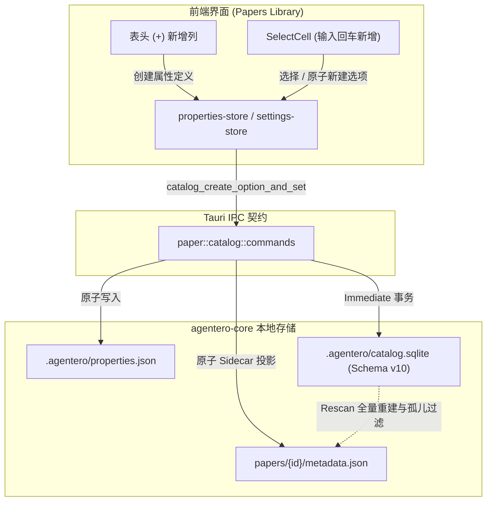

# [RFC]: Library Custom Select Properties System

## Motivation.

### Summary

Agentero 论文库当前的表格列完全由系统固化，字段与展示维度静态写死。用户无法根据自己的科研工作流（如管理阅读优先级、记录实验复现状态、标记研究方向或关联课题）在表格中自由扩展和定制专属于自己的元数据列。现有标签（Tags）仅能作为一个扁平的弱结构集合挤在同一列中，无法按用户关注的特定维度拆出独立列进行扫视、分类与整理。

本 RFC 聚焦于**本地 Vault 的自定义 Select（单选）属性系统**，解决表格不可扩展、无法深度定制的核心痛点：
1. **类 Notion 的行内表格扩展交互**：用户可通过表头 `+` 按钮随时添加自定义 Select 属性列；单元格支持下拉选择、直接输入新选项按回车（Enter）即时创建并选中，且支持自定义选项颜色。
2. **本地优先与纯文件持久化**：自定义列定义落盘至 `.agentero/properties.json`；论文取值作为原生字段存入 `PaperRecord` 并持久化在 `{paper}/metadata.json` sidecar，确保离开应用或重建数据库时数据不丢。
3. **生命周期闭环与一致性自愈**：依托行内字段设计，天然保障论文重命名移动、删除与回收站恢复时属性不丢失；在 `paper_rescan` 全量重建时提供失效属性与选项的自动过滤与净化。

### Current Baseline

| Capability | Current State | Limitations / Issues |
|---|---|---|
| 表格定制能力 | 列集合完全写死在 `COLUMN_META` 中 | 用户无法根据个人科研习惯自由扩展新列；元数据展示完全被系统硬编码约束。 |
| 分类与组织形式 | 仅能依赖单一的 `tags` 标签数组 | 各种正交的业务信息（优先级、研究方向、复现进度等）全混在同一标签列中，无法按独立列扫视与整理。 |
| 列布局与偏好 | 固定的静态 `LibraryColumnKey` 联合类型 | `normalizeLibraryColumns` 会自动丢弃未知 key；无法动态持久化用户自定义列的宽度与可见性偏好。 |
| 持久化与 Sidecar | `{paper}/metadata.json` 镜像 `PaperRecord` 字段 | 无通用属性结构；现有 `update_meta` 覆写 sidecar 时会冲掉外部未定义字段。 |
| Catalog 生命周期 | 在 `papers.rs` 中闭环（`move_under_path`、`delete_under_path` 等） | 若将属性值拆为独立关联表，在论文路径移动、软删除与回收站恢复时易产生孤儿残留与映射脱节。 |

### Target Data Flow

---

## Proposed Change.

| Feature / Area | Detailed Specification | Progress |
|---|---|---|
| **Vault 级属性定义落盘 (`.agentero/properties.json`)** | 属性定义与选项元数据（名称、颜色、排序）落盘存储于 `.agentero/properties.json`，作为纯文件真源之一。 | |
| **Catalog Schema v10 与 SQLite 镜像** | 升级 catalog 版本至 v10，新增 `custom_properties` 镜像表加速元数据检索；在 `papers` 表中新增列 `custom_props_json TEXT NOT NULL DEFAULT '{}'`。 | |
| **`PaperRecord` 原生集成与合并保护** | 在 `PaperRecord` 中增加字段 `custom_props: HashMap<String, String>`（`property_id -> option_id`）。在 `upsert_conn` 内部实现继承保护：若传入的新记录 `custom_props` 为空而库内已有该论文数据，自动保留现有属性值，避免元数据抓取或导入流水线意外覆写。 | |
| **原子 IPC 变更接口** | 实现 `catalog_create_option_and_set`，在单次后端调用中完成向 `.agentero/properties.json` 追加新选项，并原子赋值给目标论文，杜绝并发悬空选项引用。实现选项删除时联动清理受影响论文引用及重写 sidecar。 | |
| **生命周期闭环与孤儿过滤自愈** | 依托 `papers` 表内字段布局，论文路径移动（`move_under_path`）、删除（`delete_under_path`）与回收站还原（`list_under_path`）天然原子生效。在整库 `paper_rescan` 时增加孤儿过滤逻辑：丢弃不存在于 `properties.json` 的失效属性和选项，并净化重写对应 sidecar。 | |
| **动态列设置与偏好持久化** | 扩展 `LibraryColumnKey` 为 `BuiltinLibraryColumnKey | prop:${string}`。改造 `settings/store.ts` 中的 `normalizeLibraryColumns`，放行 `prop:*` 动态列的宽度（`widthRem`）与可见性（`visible`）持久化；在属性被删除时联动清理对应的偏好项。 | |
| **表头入口与 SelectCell 组件开发** | 研发 `SelectCell` 单元格组件，支持模糊搜索、按 Enter 快捷新建、复用 `TagColorPalette` 调色板改色以及就地排序；解耦 `library-paper-row.tsx` 与 `library-columns.tsx` 对固定 `COLUMN_META` 的静态索引。 | |

---

## Any Other Things.

- **非目标（RFC 1 范围边界）**：
  - 多设备云同步（S3/WebDAV/Git）策略此RFC暂不处理。
  - Multi-Select（多选）、Date（日期）、Number（数字）等其他列类型（保留为后续演进）。
  - 服务端 SQLite 索引生成或针对动态 JSON 字段的 SQL 级排序（MVP 采用当前可视页的前端就地排序）。
  - 远端 Vault 支持（MVP 仅聚焦本地 Vault，`remote_paper_list` 暂不渲染自定义属性列）。
